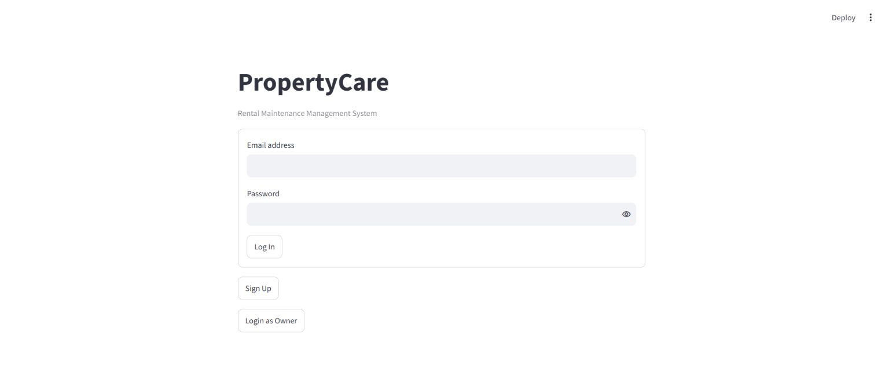
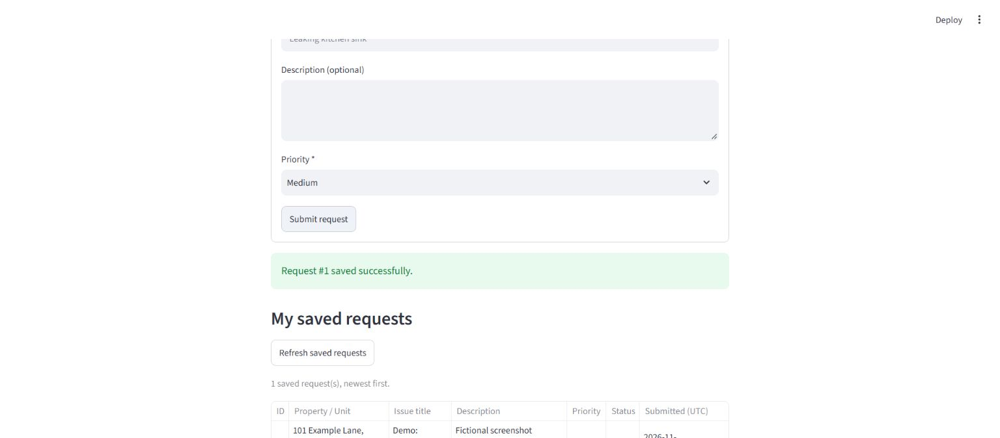
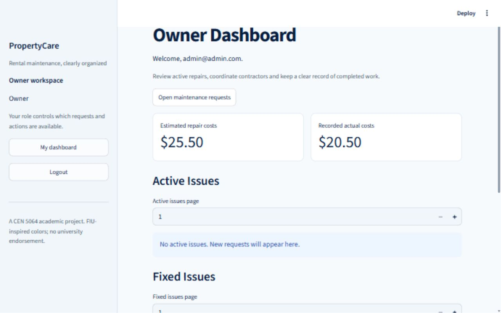
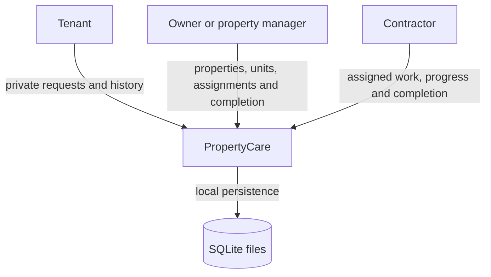
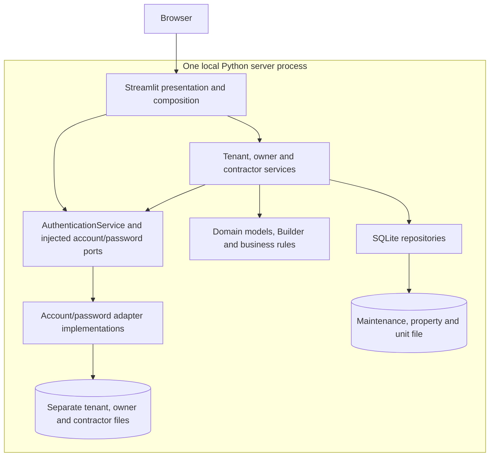
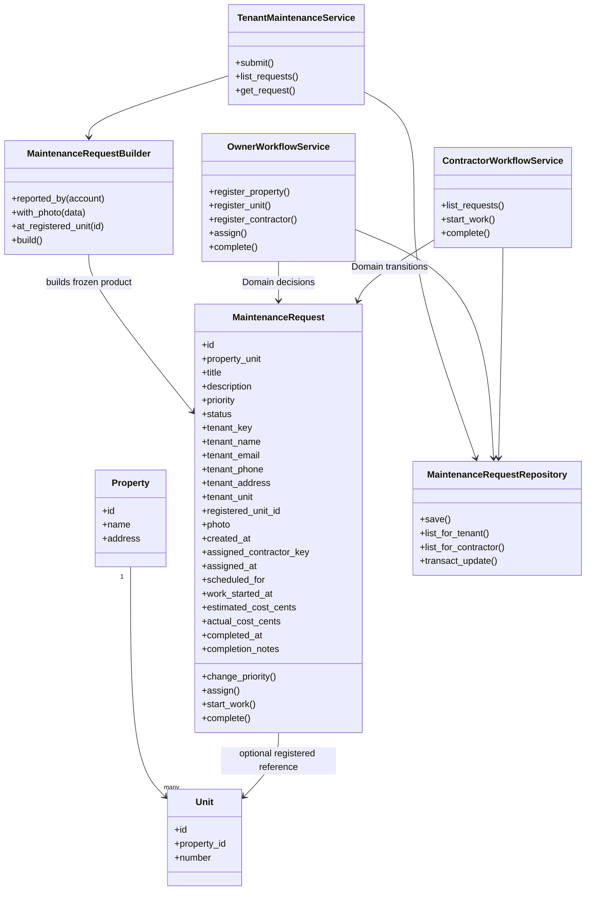
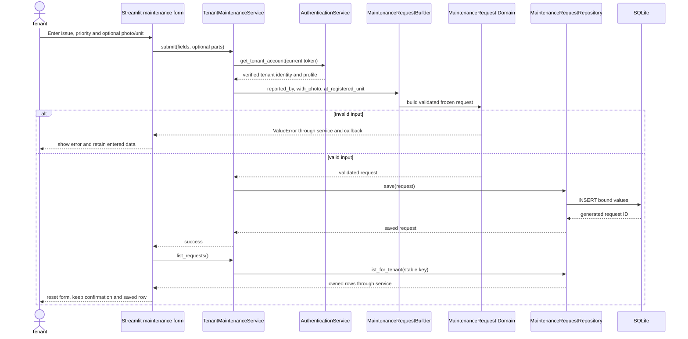
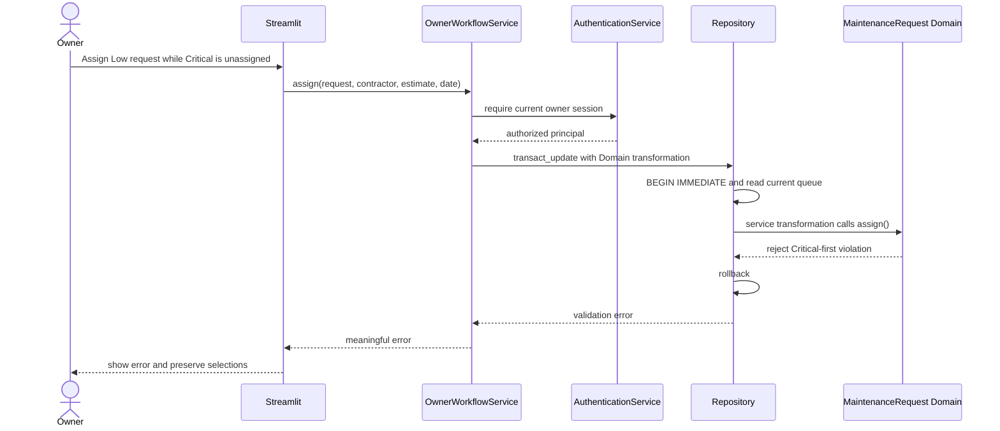
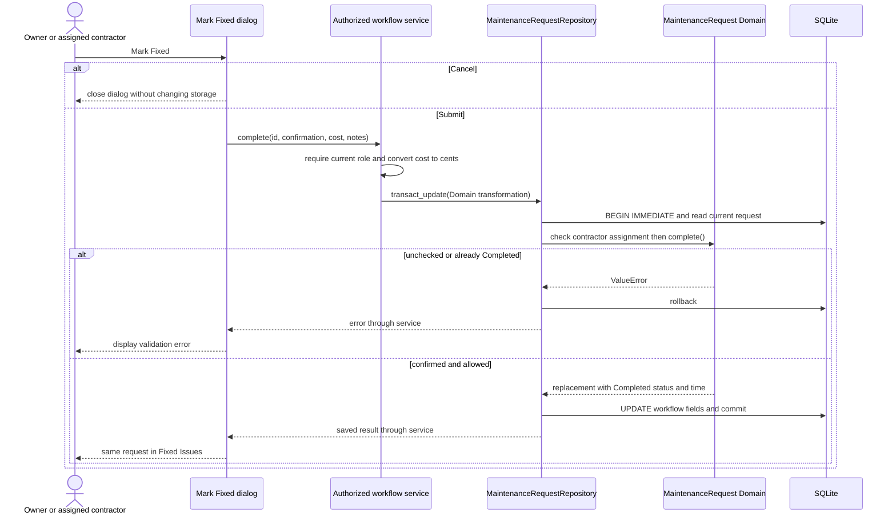

# PropertyCare

## Tested screenshots

Captured from the running local application on **November 7, 2026**, using fictional demo accounts. These are the original login and tenant-submission screenshots, restored to the README. They show the earlier authentication/private-request milestone; the inline diagrams and workflow descriptions below document the completed application on main.





[](https://github.com/JaiKaushik03/cen5064-project-Jai/actions/workflows/ci.yml)

**Student:** Jai LNU · **Course:** CEN 5064 Software Design, Fall 2026 · **Partner:** GoldLion72

## Project

PropertyCare is a rental maintenance and work-order application for tenants, property managers and contractors. It uses Streamlit, Python 3.13 and SQLite with four layers: Presentation, Service, Domain and Data.

Tenants sign up, log in and submit private maintenance requests with an optional photo and registered-unit reference. Owners register properties and units, review tenant contact snapshots, create contractor accounts, assign work and view repair history/costs. Contractors see only their assigned requests and record progress and completion. Fixed Issues retains the original request details and completion information.

**Domain owns the business rules:** unassigned Open Critical requests must be assigned before lower-priority requests; Completed requests cannot be assigned or reprioritized; completion requires explicit confirmation. Services authorize and coordinate these operations, and repositories persist their validated results.

**Current implementation:** [PR #19](https://github.com/JaiKaushik03/cen5064-project-Jai/pull/19) merged into main on November 15 after I authorized the final merge. GoldLion72's COMMENTED review identified the contractor-store corrections, which are implemented and tested. The merged implementation passed **277 tests** locally and in [main CI](https://github.com/JaiKaushik03/cen5064-project-Jai/actions/runs/43682672132). The badge above tracks the latest push to main.

## How to run

### Accessible interface and audit follow-up (redesign branch)

The interface and audit follow-up in [PR #22](https://github.com/JaiKaushik03/cen5064-project-Jai/pull/22) add navy/white screens with restrained gold accents, readable forms, keyboard focus indicators, role guidance and responsive spacing. Colors are inspired by FIU; the project has no university endorsement or official logo. All existing roles and workflows remain available.

- `.streamlit/config.toml` and `src/presentation/ui.py` centralize the palette, reusable feedback and history/photo presentation.
- Histories show 25 requests per page; use each section's page-number control to access older records. Totals include all matching records, not just the visible page. Assignment pages put unassigned Critical work first.
- Photos are retrieved only after **View photo** is selected, with authorization checked again. One validated photo is retained in session state so an unrelated action, such as completing another request, keeps the preview open. A changed request revision reloads it; logout clears it. Only photos belonging to the currently authorized history rows are displayed. PNG/JPEG validation, the 2 MiB limit and the 20-million-pixel limit remain enforced.
- **Scheduled date** starts empty and is optional. Owners may fix unassigned work themselves; contractor start/completion still requires their own assignment. Starting work is not a prerequisite for confirmed completion.
- Priority updates use a saved revision as well as status. A stale edit is rejected without overwriting the newer record; **Reload selected request** loads the current value for review before another save.
- New requests allow up to 400 characters for Property / Unit, 200 for Issue title and 10,000 for Description. Existing longer historical values remain readable and unchanged during lifecycle updates.
- `PROPERTYCARE_SESSION_TTL_SECONDS` sets an absolute session lifetime in seconds (default `3600`). Normal reruns do not extend it. Expired sessions are removed on authentication activity or explicit cleanup; SQLite records remain.
- Streamlit 1.67.0 permits the Pillow 13.0.0 security update. Development dependencies add Ruff and pip-audit; the app still uses Streamlit, Argon2id and SQLite.

Current audit details and evidence are in [redesign verification](docs/redesign-verification.md). Earlier verification records below remain dated historical evidence.



Captured November 21, 2026, against isolated fictional data. A [390-pixel mobile login screenshot](docs/screenshots/redesign-login-mobile.jpg) records the responsive layout.

Requirements: Git and Python **3.13**. Clone and run from the repository root. These commands use main; when reviewing a feature branch, switch to that branch before installing its dependencies.

### Windows Command Prompt or PowerShell

```bat
git clone https://github.com/JaiKaushik03/cen5064-project-Jai.git
cd cen5064-project-Jai
py -3.13 -m venv .venv
.\.venv\Scripts\python.exe -m pip install -r requirements.txt
.\.venv\Scripts\python.exe -m scripts.seed_demo_accounts --local-demo
.\.venv\Scripts\python.exe -m streamlit run app.py --server.address 127.0.0.1
```

Open **http://localhost:8501** while the server runs. If Streamlit asks for an onboarding email, press Enter. Stop with **Ctrl+C** and restart with the same Streamlit command. Calling the environment's Python directly works in both shells without activation or an execution-policy change.

### Linux or macOS

```bash
git clone https://github.com/JaiKaushik03/cen5064-project-Jai.git
cd cen5064-project-Jai
python3.13 -m venv .venv
.venv/bin/python -m pip install -r requirements.txt
.venv/bin/python -m scripts.seed_demo_accounts --local-demo
.venv/bin/python -m streamlit run app.py --server.address 127.0.0.1
```

### Local accounts and explicit demo setup

| Login | Email | Password |
|---|---|---|
| Tenant | user1@login.com | user1 |
| Tenant | user2@login.com | user2 |
| Tenant | user3@login.com | user3 |
| Owner | admin@admin.com | admin |

Demo profiles are fictional. The explicit `--local-demo` setup is repeatable: it does not overwrite existing accounts or reset passwords. It refuses a non-local `PROPERTYCARE_ENV`; startup never silently creates demo users. These weak published credentials are for the local course demonstration. Use fictional details and passwords that are not used elsewhere.

Owners create contractor accounts under **Manage contractors and assignments**, using a name, email and initial password. New passwords, including contractor passwords, require 12–128 characters with a letter and a number. Contractor signup is not public. Use **Login as Contractor** with the account the owner created. Contractor creation clears the masked password field after each attempt.

The seeder creates three fictional tenant profiles and one owner, with a demo-seed terms version. Repeating it does not replace existing credentials, profiles, keys or IDs. Login passwords are never prefilled. The weak demo passwords are exceptions in the explicit local seeder; new signup and contractor passwords use the normal password policy.

### Login, signup, and logout

The first screen provides **Log In**, **Sign Up**, **Login as Owner**, and **Login as Contractor**. Each login checks its separate account store. Owners have no public signup; an authenticated owner provisions contractors.

Tenant signup requires Full Name, Email Address, Phone Number, Address, Unit Number, Password, Confirm Password, and terms acknowledgement. Emails are normalized and unique ignoring case; phone input accepts common punctuation and 10-15 digits. The optional updates checkbox records a preference only. Signup validation errors preserve entered values, including both masked password fields for correction. Success clears the form and passwords, returns to login, prefills the normalized email and displays confirmation.

Successful login stores an opaque server-issued token and selects the role's dashboard. The service rechecks role/account/store identity on protected operations. Logout revokes the token and clears private application state. Successful account switches and expired protected sessions clear old drafts and feedback; URL parameters do not grant a role.

### Database setup and password protection

| SQLite file | Contents |
|---|---|
| data/tenant_accounts.db | Tenant profiles, Argon2id hashes, stable account keys and signup acknowledgements |
| data/owner_accounts.db | Owner credentials |
| data/contractor_accounts.db | Owner-created contractor credentials and stable contractor keys |
| data/propertycare.db | Properties, units, requests, contact snapshots, photos, assignments, costs and retained history |

Files are created automatically and ignored by Git. Credential files reject the opposite account tables and maintenance tables; maintenance startup also rejects credential paths. `PROPERTYCARE_AUTH_DATA_DIR` selects the directory for all three account filenames; `PROPERTYCARE_DB_PATH` selects the maintenance file. Tests/browser checks use isolated stores. Back up all files together.

Migrations use transactions and add missing columns/tables without rebuilding existing rows or resetting IDs/sequences. Legacy requests remain owner-only when their tenant key is unknown. Missing historical snapshots stay unknown. Existing accounts are not reseeded or overwritten. Request and contractor ownership uses UUID keys so a replacement account with a reused numeric ID cannot inherit old history.

Passwords use salted Argon2id. Server-side opaque sessions resolve current roles and account/store identities on each operation. Presentation guards are backed by service authorization; hiding a button is not the access check. Sessions live in one server process, expire after the configured lifetime, and end on server restart. Restart the server after installing dependencies or changing authentication code. This is a local academic application, not a production identity or multi-server platform.

No separate database server, manual SQL, secret file or populated database download is required. Passwords use Argon2id through pinned argon2-cffi 25.1.0, with fresh salts, 64 MiB memory, three iterations and parallelism four. Password fields clear after login attempts, successful signup, navigation and logout. Failed signup retains them only in the active form until correction or navigation.

## How to test

Windows Command Prompt or PowerShell:

```bat
.\.venv\Scripts\python.exe -m pip install -r requirements-dev.txt
.\.venv\Scripts\python.exe -m pytest -q
.\.venv\Scripts\python.exe -m pip check
.\.venv\Scripts\python.exe -m ruff check .
.\.venv\Scripts\python.exe -m pip_audit -r requirements-dev.txt --strict --progress-spinner off
```

On Linux/macOS substitute `.venv/bin/python`. The full suite passes **321 cases**: all 277 existing cases plus 44 audit and photo-review regressions. The existing cases comprise the 227-case baseline, 40 final workflow checks and 10 contractor-store review regressions. Coverage includes Domain decisions, Builder products, exact costs, actual image validation, safe legacy migrations, rollback, privacy, role boundaries, account replacement, confirmation/cancellation, Streamlit form behavior, persistence, concurrent edits, bounded histories, session expiration and persistent photo previews. Current results are in [redesign verification](docs/redesign-verification.md); [final verification](docs/final-verification.md) retains the earlier milestone evidence.

Contractor storage is optional when constructing the authentication service for tenant/owner-only use. Owner contractor registration, listing and assignment require a configured contractor store and raise a clear `ValueError` when it is absent. Owner authorization is checked first; normal app startup supplies the store automatically.

The original professor-requested service/SQLite priority cases remain available:

```bat
.\.venv\Scripts\python.exe -m pytest -q tests/test_priority_updates.py -k "allowed_change or completed_change"
```

The allowed case persists an Open request's priority change and reloads it through a new repository/service. The rejected case verifies the Domain error and that storage was not updated. Other tests cover Critical-first assignment, confirmation/cancellation, costs/photos, stable identities, role isolation, migrations, rollback and real Streamlit form behavior.

## Architecture

### Tier breakdown (Session 2 studio)

The table names the actual implementing files and responsibilities in the completed application.

| Layer | Files | Responsibility |
|---|---|---|
| Presentation | app.py; src/presentation/auth_views.py, maintenance_view.py, owner_views.py | Composition, guarded screens, forms, tables, session/widget state; no SQL |
| Service | AuthenticationService, TenantMaintenanceService, OwnerMaintenanceService, OwnerWorkflowService, ContractorWorkflowService, MaintenanceRequestService | Current-account authorization and use-case coordination through injected dependencies |
| Domain | accounts.py, maintenance_request.py, priority.py, request_status.py, properties.py, work_orders.py, request_builder.py | Account/request validation, immutable products, assignment order, completion, cost/image constraints |
| Data | account_repositories.py, contractor_repository.py, maintenance_request_repository.py | Separate account stores, bound SQL, transactional migrations and request persistence |

### C4 — Context & Container (Session 3 studio)

The context diagram includes all three implemented actors. The container diagram shows the actual local-process dependency paths and separate credential/maintenance files.





Presentation contains no SQL. Services obtain the current principal and coordinate Domain and Data operations. Domain functions contain the business decisions. Data owns connections, bound SQL and transaction boundaries. The request-update transaction receives a service-supplied transformation; it does not decide the assignment or completion rules itself.

### UML — Class & Sequence (Session 3 studio)

#### Class diagram



The final code stores assignment, progress and cost fields in the frozen **MaintenanceRequest** aggregate. There is no separate WorkOrder class or table. The [original planned design](docs/planned-design.md) preserves that earlier proposal as history; this diagram shows the implementation.

#### Sequence diagram - Submit and view a maintenance request



#### Sequence diagram - Critical-first assignment and rejection



The Domain evaluates the current queue inside a serialized **BEGIN IMMEDIATE** read/decision/write transaction. Once all Open Critical requests have been assigned, lower-priority assignments are allowed; the Critical repair need not be completed first.

#### Sequence diagram - Confirm completion and retain history



Owner completion requires an owner session. Contractor completion additionally checks the assigned stable key inside the transaction. A successful transition preserves original fields, adds the completion time, cost and notes, and displays the stored Completed row as Fixed.

### SOLID refactor: Dependency Inversion

The Lecture 5 refactor is tracked by [Issue #14](https://github.com/JaiKaushik03/cen5064-project-Jai/issues/14)
and [PR #15](https://github.com/JaiKaushik03/cen5064-project-Jai/pull/15). Its review
clarification records that the demo seeder is separate from the authentication
policy refactor.

`AuthenticationService` already accepted repository arguments, but it imported
the concrete SQLite classes, rejected other implementations, compared database
paths directly, and constructed `Passwords()` when no adapter was supplied.
That tied authentication policy to its storage and hashing implementations.

The service now depends on `TenantAccountStore`, `OwnerAccountStore`, `ContractorAccountStore`, and
`PasswordCodec` protocols in `src/services/authentication_ports.py`. The cached
startup factory in `src/presentation/auth_views.py` supplies the existing SQLite
repositories and Argon2id adapter. Protocols use structural typing: an adapter
provides the required operations without inheriting from the SQLite classes.
Store roles and distinct identities are still validated; these interfaces are
internal startup dependencies, not a way for browser users to choose roles.

The visible workflows, password settings, account files, schema, session checks,
and earlier signup corrections remain the same. In-memory service tests prove
that another adapter works without changing authentication policy. A fresh-process
test also blocks SQLite/Argon2 adapter imports when importing that policy.

For a historical refactor-only review clone:

```bash
git clone --branch codex/solid-authentication-dip https://github.com/JaiKaushik03/cen5064-project-Jai.git propertycare-solid-review
```

Use the normal environment, installation and demo setup commands inside that
clone. Use the selected virtual environment's Python for `-m pytest -q tests/test_authentication_ports.py`
and for the full `-m pytest -q` suite, as shown in How to test above. See [the refactor explanation and
verification](docs/solid-refactor.md). The SOLID refactor, tenant-owned requests and complete owner/contractor workflow are now merged into main.

### Creational pattern: Builder

`MaintenanceRequestBuilder` assembles required issue fields and named optional parts, then constructs a validated immutable request:

```python
request = (MaintenanceRequestBuilder(property_unit, title, description, priority)
           .reported_by(current_account)
           .with_photo(photo)
           .at_registered_unit(unit_id)
           .build())
```

The Builder does not authenticate, render widgets or save records. `MaintenanceRequest.__post_init__()` owns validation. [The pattern map](docs/pattern-map.md) assesses all five creational patterns; cached authentication composition is scoped resource reuse rather than a strict global Singleton.

The expanded [final design](docs/final-design.md) includes these diagrams, persistence notes and the risk/mitigation table.

## Part 1: tenant-owned requests and history

[Issue #16](https://github.com/JaiKaushik03/cen5064-project-Jai/issues/16) and [PR #17](https://github.com/JaiKaushik03/cen5064-project-Jai/pull/17) record the reviewed and merged tenant-ownership slice.

1. Log in or choose Sign Up. Signup requires name, email, phone, address/unit, matching passwords and the academic terms acknowledgement. The optional updates preference sends no notifications.
2. Open **My maintenance requests**. Property / Unit initially uses the saved address/unit and stays editable. Property / Unit, Issue title and Priority are required; Description is optional.
3. Optionally link a registered unit and attach a PNG/JPEG of at most 2 MiB and 20 million pixels. Actual image content is decoded and validated before storage; renaming a file does not make it an image.
4. Submit. Success clears the text, optional unit selection and upload, resets Priority to Medium, preserves the confirmation and displays the saved request. Validation failure retains the entered form values.
5. View only your own persisted history and photos. Another tenant's request ID does not grant access. Logout and a new login clear private drafts, uploads and feedback.

Each new tenant request records a snapshot of their name, email, phone, address and unit. A later account/profile change cannot rewrite that snapshot. Registered-unit linking is a maintenance catalog reference, not a lease-verification system; tenants can still report an unregistered location. Request ownership always comes from the current authenticated account, never the selected unit or browser-supplied identity.

Persistent UUID account keys are independent of numeric IDs, email spelling and database location. Tenant reads bind the current key in SQL; a foreign request ID and a missing ID return the same not-found result. Migrations keep unknown legacy ownership NULL and owner-only. Session/key rechecks prevent a recreated account from inheriting another account's old session or history. See [the ownership verification record](docs/tenant-request-verification.md).

## Maintenance request workflow

The tenant screen and preserved owner maintenance workspace share required-field labels, optional Description, the four-priority dropdown and success/failure behavior. The owner wrapper authorizes access before calling the shared maintenance service. Owner-created requests do not invent a tenant identity or historical contact snapshot.

Property / Unit and Issue title require non-whitespace text. Description is optional free-form text: digits such as `"123"` are valid text; non-string values are rejected. Domain validates before a save. After success the text clears, Priority resets to Medium, the optional unit/upload resets, and confirmation plus the saved row remain visible. Failed submission retains the entered request values.

### Manager priority-change workflow

**Domain owns the Completed-request restriction.** `MaintenanceRequest.change_priority()` returns a validated replacement for Open work and rejects Completed work. Service retrieves the request and saves only after that decision succeeds. `MaintenanceRequestService` depends on the service-owned `MaintenanceRequestStore` Protocol; startup supplies the SQLite implementation.

1. Log in as owner and choose **Open maintenance requests**.
2. Select a request under **Manager - Change Request Priority**.
3. **New priority** starts at that selected request's saved priority. Changing the selection loads its current value without saving.
4. Choose an allowed priority and click **Update Priority**. Open work updates; Completed work displays the Domain error and retains the proposal/selection.

The repository updates only priority and its revision with bound parameters and status/revision-match conditions. The screen retains its loaded revision until a successful save or explicit reload, preventing older proposals and concurrent writers from silently overwriting current work. This consistency check does not take ownership of the Domain rule.

### Owner, contractor, and retained completion workflow

The **Owner Dashboard** contains Active Issues and Fixed Issues with request details, tenant contact snapshots, priorities, original submission times, assignment/progress, estimated/actual costs and completion times. Older rows with no verified contact information display **Unavailable (legacy/unassigned)**. Older Completed fixtures may have no known completion time; no timestamp or contact history is invented.

- **Manage properties and units:** register a property and its units. Duplicate registrations are rejected. Select a registered unit to see its maintenance history and repair costs.
- **Manage contractors and assignments:** create contractor credentials, select an unassigned request and contractor, enter an estimate and scheduled date, then Assign work.
- **Critical-first rule:** an unassigned, Open Critical request must be assigned before any lower-priority request. The Domain decides this rule inside a serialized SQLite read/decision/write transaction. Assigning Completed or already assigned work is rejected without changing storage.
- **Contractor Dashboard:** displays only the signed-in contractor's assigned requests. Start work records progress; Mark Fixed records completion. Another contractor's account or ID cannot access or complete that work. Owners retain oversight of the shared maintenance portfolio.
- **Mark Fixed:** opens a dialog with a required confirmation checkbox, actual repair cost and optional completion notes. Submit without confirmation is rejected. Cancel leaves the stored request unchanged. Success moves the row to Fixed Issues while preserving its ID, original details, contact snapshot, photo and submission time, and adds a completion time. No deletion occurs.
- **Open maintenance requests:** preserves the earlier owner submission/table/priority workspace. New priority loads the selected request's saved priority. Domain rejects all priority changes once the request is Completed.

**Fixed** is the display term for stored `Completed`; the original `Open`/`Completed` states are preserved. Assignment and In Progress are recorded separately. Costs are exact integer cents; negative, non-finite and more-than-two-decimal amounts are rejected. Zero is allowed. The course application records costs; it does not make payments.

## Maintenance Request Priority Levels

| Priority | Meaning in the interface |
|---|---|
| Low | Minor maintenance issue. |
| Medium | Normal maintenance issue; default submission value. |
| High | Important issue affecting normal use of the property. |
| Critical | Urgent or safety-related issue; Open unassigned Critical work must be assigned first. |

Tenants select an initial priority; owners can review and change it while the request is Open. Priority labels are not a promised response-time service agreement.

## Maintenance Request Images

Tenants and owners may attach a PNG or JPEG when submitting a request. Upload is optional. Domain checks the actual bytes, a **2 MiB** size limit and a **20-million-pixel** limit, verifies the format and fully decodes the body. A renamed non-image or truncated image is rejected before persistence.

The photo is stored in the request's SQLite BLOB column and remains available to the authorized tenant, owner and assigned contractor after completion. It is not an image-path reference to an external upload folder.

## Architecture Decision Records

Decisions live in [`docs/adr/`](docs/adr/). These six records explain the choices made for PropertyCare; each contains Context, Decision and Consequences.

| Decision | Status |
|---|---|
| [ADR 001: Layered Architecture](docs/adr/adr-001-layered-architecture.md) | Accepted |
| [ADR 002: SQLite Persistence](docs/adr/adr-002-sqlite-persistence.md) | Accepted |
| [ADR 003: Separate authentication](docs/adr/adr-003-separate-authentication.md) | Accepted; contractor extension recorded |
| [ADR 004: Stable request ownership](docs/adr/adr-004-tenant-request-ownership.md) | Accepted; contact snapshots and stable assignment identity recorded |
| [ADR 005: Retained maintenance lifecycle](docs/adr/adr-005-retained-maintenance-lifecycle.md) | Accepted |
| [ADR 006: Request Builder](docs/adr/adr-006-request-builder.md) | Accepted |

The ADR template and worked example remain course references and are not counted as PropertyCare decisions.

## CI

GitHub Actions uses Python 3.13 and runs the complete suite on pushes to `main` and PRs targeting `main` or `codex/**`. The badge near the top shows the latest main-push result. [PR #19](https://github.com/JaiKaushik03/cen5064-project-Jai/pull/19) records the partner correction, clean-clone test and merge receipts; [final verification](docs/final-verification.md) preserves the dated checks and manual-browser limits.

## Demo

1. Run the explicit local-demo setup, start Streamlit, and open http://localhost:8501.
2. Log in as Tenant 1, open **My maintenance requests**, and submit one Critical and one Low request. Show validation retention, success/reset, optional photo/unit and the saved contact snapshot.
3. Log out and log in as Tenant 2. Tenant 1's history is absent.
4. Log in as owner. Inspect Active Issues and the contact snapshots; register a property/unit and create a contractor if needed.
5. Attempt to assign Low while Critical is unassigned. Show the Domain rejection; then assign Critical with an estimate and scheduled date.
6. Log in as that contractor. Show only assigned work and use **Start work**.
7. Use **Mark Fixed**. Reject unchecked confirmation, try Cancel, then confirm with actual cost/notes. Show the same retained request in Fixed Issues.
8. As owner, attempt to change the Completed request's priority and show the Domain rejection. Inspect unit history, costs and retained photo.
9. Stop/restart the application, log in again and show persisted history. Server-side login sessions are recreated after restart.

For a two-minute professor check-in, prepare the catalog/accounts first and focus on tenant-private history, Critical-first rejection/assignment, confirmed completion, retained Fixed Issues and the Completed priority restriction.

## Semester scope and future work

The original course scope is implemented: property/unit registration, private tenant requests/contact snapshots, optional photos, owner Active/Fixed views, contractor provisioning/assignment/progress, confirmed completion, retained history and exact-cent repair costs. Assignment data lives in the MaintenanceRequest aggregate rather than the originally proposed separate WorkOrder entity.

Lease verification, payments, actual notification delivery, profile editing, password recovery and public/multi-server production deployment are outside the implemented course scope. The optional updates field records a preference only. [The original full-semester proposal](docs/planned-design.md) remains explicitly historical; [the owner workflow](docs/future-owner-workflow.md) and final diagrams describe the implemented result.

## Project tracking

[PropertyCare Midterm Board](https://github.com/users/JaiKaushik03/projects/1) is the linked course project board. Repository issue and PR records below contain the verified implementation/merge receipts; a fresh manual board edit is not claimed.

| Work | Implementation status | Tracking |
|---|---|---|
| Four supported priorities and Domain validation | Implemented | [Issue #3](https://github.com/JaiKaushik03/cen5064-project-Jai/issues/3), [PR #4](https://github.com/JaiKaushik03/cen5064-project-Jai/pull/4) |
| Submit, validate, save and display requests | Implemented | [Issue #5](https://github.com/JaiKaushik03/cen5064-project-Jai/issues/5), [PR #7](https://github.com/JaiKaushik03/cen5064-project-Jai/pull/7) |
| Open priority changes; Completed rejection | Implemented; review corrections addressed | [PR #9](https://github.com/JaiKaushik03/cen5064-project-Jai/pull/9) |
| Tenant/owner authentication and signup | Implemented; signup feedback addressed | [Issue #12](https://github.com/JaiKaushik03/cen5064-project-Jai/issues/12), [PR #13](https://github.com/JaiKaushik03/cen5064-project-Jai/pull/13) |
| Authentication Dependency Inversion | Implemented and merged | [Issue #14](https://github.com/JaiKaushik03/cen5064-project-Jai/issues/14), [PR #15](https://github.com/JaiKaushik03/cen5064-project-Jai/pull/15) |
| Tenant-owned submission and history | Implemented; prefill feedback addressed | [Issue #16](https://github.com/JaiKaushik03/cen5064-project-Jai/issues/16), [PR #17](https://github.com/JaiKaushik03/cen5064-project-Jai/pull/17) |
| Full owner/contractor workflow and retained completion | Implemented and merged | [Issue #1](https://github.com/JaiKaushik03/cen5064-project-Jai/issues/1), [Issue #10](https://github.com/JaiKaushik03/cen5064-project-Jai/issues/10), [PR #19](https://github.com/JaiKaushik03/cen5064-project-Jai/pull/19) |
| Five-pattern assessment and Builder | Implemented and merged | [Issue #18](https://github.com/JaiKaushik03/cen5064-project-Jai/issues/18), [pattern map](docs/pattern-map.md) |

## Development and verification

I set the project direction, supplied requirements and professor feedback, defined acceptance criteria and selected the full final scope. I used Codex for most of the implementation, including Domain changes, service coordination, SQLite migration, Streamlit updates, automated tests and technical documentation. The [verification history](docs/verification.md), [authentication record](docs/authentication-verification.md), [tenant ownership checks](docs/tenant-request-verification.md) and [final checks](docs/final-verification.md) identify the actual checks performed.

GoldLion72's reviews informed the priority dropdown default, signup correction behavior, tenant location prefill and contractor-store typing/error handling. Their review on PR #19 covered `b728008` with COMMENTED status; the corrections were implemented in `9a0cf11`. I authorized the final merge. These records do not claim a formal partner approval or a second review that did not occur. The implementation PRs retain their AI-critique blocks with concrete findings and corrections.

## Weekly log

These historical entries preserve the earlier README's milestone record. Statements about pending work describe the date of each entry; the current implementation and merge status are recorded above and in the November follow-ups. Existing commit dates are not rewritten or backfilled.

- Week 1 (Aug 24): Repository created, three project ideas drafted, PropertyCare selected, and the approval paragraph added.
- Week 2 (Aug 31): Defined the four-tier architecture and its responsibilities.
- Week 3 (Sep 7): Created C4 diagrams, the initial UML class diagram, and the maintenance-request sequence.
- Week 4 (Sep 14): Expanded the planned design with optional images and four priority levels.
- Week 5 (Sep 21): Started Issue #1's planned login and owner portal workflow documentation.
- Week 6 (Sep 28): Implemented Domain priority validation, unit tests, AI critique, and peer-review README feedback.
- Week of Oct 5 (Oct 10): Implemented the submit-and-view workflow, SQLite persistence, interface/integration tests, two real ADRs, CI, and reproducible run instructions.

- Oct 10 follow-up: Re-audited existing work, corrected issue/PR descriptions and attribution, verified feature-branch setup, and added service/storage-boundary checks for partner review.

- Oct 18: Added manager priority updates, Domain-owned Completed restriction, minimal request status, safe SQLite migration, and regression coverage. Local suite: 69 passed, 0 failed. Verified both real browser workflows and restart persistence against an isolated legacy database; the initial implementation was handed off as a Draft PR before peer review.

- Oct 18 partner-review follow-up: Matched the manager priority default to the selected request, added selection/rerun regression tests, clarified contribution credit, and recorded the completion UI as future Issue #10. I subsequently authorized merging the corrected implementation without a second review; the recorded partner review remains COMMENTED, not a formal approval.

- Oct 24: I supplied the authentication/signup flow, fields, account separation, demo credentials, interface decisions, and future owner workflow requirements. Codex implemented the authentication slice, preserved maintenance behavior behind owner access, and performed the automated/database/browser verification. The initial handoff was an open PR for peer review; see the October 25 follow-up below.


- Oct 25 partner-review follow-up: GoldLion72 suggested preserving signup passwords after validation errors and prefilling the login email after account creation. Codex implemented both using form callbacks, added retry/navigation/prefill regression checks, and ran all 173 tests successfully. I authorized merging the corrected PR after verification; the partner review remains COMMENTED, with no formal approval claimed.

- Oct 30–31: Refactored authentication around service-owned account/password interfaces for Lecture 5 Dependency Inversion. Added independent in-memory tests, retained the 173-case baseline, and verified 184 passing tests plus the unchanged browser workflows. The SOLID PR is awaiting partner review.

- Oct 31: Added Part 1 tenant-owned requests and private history, stable account keys, repeatable legacy migrations, session/draft isolation and 41 new cases. Full branch suite: 225 passed. Verified two-tenant privacy and restart behavior in Chrome against isolated data; verified migration copies preserve existing records. The Part 1 PR remains separate and unmerged for review.

- Nov 1 review follow-up: Recorded the demo seeder boundary and added editable tenant address/unit prefill. Validation errors preserve entered location values; successful submissions still clear the form. PR #15 and PR #17 record the verification and merge results.

- Nov 7: Added the two verified local-application screenshots preserved at the top of this README.
- Nov 8-9: Implemented the final owner/contractor lifecycle, safe additive migrations, photos/costs/catalog, Builder assessment, diagrams and 267-case verification; handed off PR #19 for partner review.
- Nov 13-15: GoldLion72 reviewed PR #19. The optional contractor-store correction and ten regressions brought the suite to 277. Fresh-clone setup passed; I authorized merge into main at `b415c2e`, with green merged-main CI.
