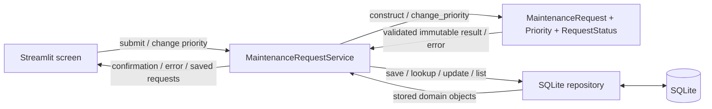

# PropertyCare

[](https://github.com/JaiKaushik03/cen5064-project-Jai/actions/workflows/ci.yml)

**Student:** Jai LNU · **Course:** CEN 5064 Software Design, Fall 2026 · **Partner:** GoldLion72

## Project

PropertyCare is a rental maintenance and work-order project for tenants, property managers, and maintenance contractors. The working application lets a tenant submit and view maintenance requests and lets a manager change an Open request's priority. The Domain rejects priority changes to Completed requests. Requests and updated priorities are stored in SQLite and displayed again after restarting the application. The manager section is a demonstration interface; it does not authenticate users or enforce roles.

## How to run

Requirements: Git and Python **3.13**. Run these commands in Windows Command Prompt to clone and start PropertyCare:

```bat
git clone https://github.com/JaiKaushik03/cen5064-project-Jai.git
cd cen5064-project-Jai
py -3.13 -m venv .venv
.venv\Scripts\activate
python -m pip install -r requirements.txt
python -m streamlit run app.py
```

To try the October 18 implementation while PR #9 is still unmerged, run `git switch feature/manager-priority-update` after entering the cloned repository, before starting the app. The clone command otherwise checks out `main`.

Open **http://localhost:8501** while the server is running. If Streamlit asks for an onboarding email, press Enter to skip it. Stop with **Ctrl+C** and restart with the same Streamlit command.

For PowerShell, activate with `.\.venv\Scripts\Activate.ps1`; use Command Prompt if execution policy blocks activation.

On Linux/macOS with Python 3.13 installed, use `python3.13 -m venv .venv` and `source .venv/bin/activate` in place of the Windows environment commands; the pip, Streamlit, and test commands are the same.

### Database setup

The first run creates `data/propertycare.db` and its table automatically; no database server, credentials, or schema commands are needed. Requests and priority changes remain after restarting. The default database path is relative to `app.py`.

On startup, the repository inspects the existing table inside a transaction. If `status` is missing, it adds `status TEXT NOT NULL DEFAULT 'Open'` using `ALTER TABLE`. All existing requests become **Open** because the old schema did not record completion. IDs, property/unit details, titles, descriptions, priorities, timestamps, and the ID sequence are preserved. Repeated initialization does not add another column or recreate the table. New requests also default to Open.

Statuses are limited to Open and Completed. There is no general status-change or completion interface in this assignment. Tests construct Completed fixtures directly.

Database files are ignored by Git. Optional `PROPERTYCARE_DB_PATH` selects another file; tests use isolated databases.

## How to test

From the repository root, with the virtual environment activated:

```bash
python -m pip install -r requirements-dev.txt
python -m pytest -q
```

Tests cover priority and status rules, required fields, validation before storage, SQLite persistence, migration, and the Streamlit submission form and manager controls. The full suite contains **75 tests**. All existing submission/reset/validation tests are retained.

Run the professor's two required service/SQLite cases separately with:

```bash
python -m pytest -q tests/test_priority_updates.py -k "allowed_change or completed_change"
```

The allowed case saves an Open request, changes Medium to High, checks every stored field, and reloads through a fresh repository/service. The rejected case uses a Completed request, checks the meaningful Domain error, proves the repository update method was never called, and reloads the unchanged stored record. Additional tests cover all four priorities, invalid values, missing IDs, immutable replacements, repeated old-schema migration, ID sequence preservation, stale status, connection cleanup, UI success/error, and restart persistence.

## Architecture

| Layer | Implementing files | Responsibility |
|---|---|---|
| Presentation | `app.py` | Submission form and manager controls, callback/session-state handling, feedback, and saved table; calls the service and wires dependencies. |
| Service | `src/services/maintenance_request_service.py` | Coordinates retrieval, Domain validation, and persistence; handles missing IDs and returns results. |
| Domain | `src/domain/maintenance_request.py`, `src/domain/priority.py`, `src/domain/request_status.py` | Frozen request model, required fields, priority/status enums, and the Completed priority-change restriction; no UI or database dependency. |
| Data | `src/data/maintenance_request_repository.py` | SQLite migration, parameterized insert/lookup/update, transactions and connection cleanup; loads domain objects and updates only priority. |



## Maintenance request workflow

**Flow:** Tenant submits request -> service validates by creating the
domain model -> SQLite repository saves -> service loads saved requests ->
Streamlit displays confirmation and the stored record.

Priority must be exactly **Low, Medium, High, or Critical**,
using the existing `Priority` enum. Property / Unit and Issue title must contain
non-whitespace text. Description is optional. Invalid data raises a domain
validation error before the service calls storage; the UI displays that error.

Fields marked * are required. After a successful save, the text fields clear and priority resets to Medium; the confirmation and saved request remain visible. Validation errors preserve entered values.

### Manager priority-change workflow

**Domain owns the business rule that completed maintenance requests cannot have their priorities changed.** `MaintenanceRequest.change_priority()` rejects Completed requests and returns a validated replacement for an Open request. The original dataclass stays frozen. Low, Medium, High, and Critical remain the only valid priorities.

**Service coordinates retrieval, validation, and persistence.** `change_priority(request_id, priority)` retrieves the request, reports a missing ID, calls the Domain method, and persists the returned object only if validation succeeds. It does not repeat the Completed decision.

**Data layer performs SQLite reads and writes.** `get_by_id()` uses a bound ID; `update_priority()` updates only the priority with bound parameters and commits the transaction. A status-match condition rejects a stale record if its status changed between lookup and update. That generic consistency check does not decide which status permits an edit; Domain owns that decision.

To use the interface:

1. Submit a request or use an existing saved request. The table shows its ID, priority, and status.
2. In **Manager - Change Request Priority**, select the request by ID/title/property.
3. **New priority** starts at the selected request's saved priority. Selecting another request immediately loads its current priority without saving a change. Choose the desired priority and click **Update Priority**.
4. For an Open request, the app displays success and reloads the saved table with the new priority. The same ID, details, timestamp, and status remain.
5. For a Completed request, the app displays the Domain validation error. Its priority stays unchanged and the manager's selection is preserved. A missing/deleted request produces a clear error.

The submission Priority starts at Medium and resets to Medium after a successful save. The manager's New priority starts at the selected request's current value. Session state supplies these values; an unrelated rerun or failed update keeps the proposed manager value for the same request. Update callbacks run before the next screen render. Dependent widget state is assigned before that widget is rendered. Completed fixtures are exercised in automated tests; this demo does not provide a completion button.

## ADRs

| Decision | Status |
|---|---|
| [ADR 001: Layered Architecture](docs/adr/adr-001-layered-architecture.md) | accepted |
| [ADR 002: SQLite Persistence](docs/adr/adr-002-sqlite-persistence.md) | accepted |

The original ADR template and worked example remain as course references.
They are not counted as PropertyCare decisions.

## CI

GitHub Actions uses Python 3.13 and runs `python -m pytest -q` for pushes to `main` and pull requests targeting `main`. The badge at the top shows CI for pushes to `main`.

## Demo

1. Open http://localhost:8501.
2. Enter **Oak Court / Unit 2B**, **Leaking kitchen sink**, and **Water pools below the cabinet.** Keep the default priority **Medium**.
3. Click **Submit request**. Show the success message and matching row in **Saved maintenance requests**.
4. Select that request in **Manager - Change Request Priority**, choose **High**, and click **Update Priority**. Show the confirmation and the updated table.
5. Stop the server with Ctrl+C, restart with `python -m streamlit run app.py`, and refresh the browser. Show that the row remains.
6. Enter **Oak Court / Unit 2B**, leave Issue title blank, and click **Submit request**. Show the validation message and that the saved-request count does not increase.
7. Show the Completed rejection test and the service spy proving no update call; briefly explain the Domain method.
8. Show the README layer table and the passing PR CI result. The badge tracks `main`; it does not represent an unmerged Draft PR.

## Semester scope and future work

The broader design includes registered properties and units, login and role-based
owner access, optional request images, work orders, assignment, a general status-change workflow,
maintenance history, and repair costs. These features are planned and are **not**
implemented in the current application. Only minimal Open/Completed representation exists for the priority rule; there is no completion workflow. The original C4/UML diagrams and priority/image
design are preserved in [the planned full-semester design](docs/planned-design.md).

[Issue #5](https://github.com/JaiKaushik03/cen5064-project-Jai/issues/5) tracks the maintenance request workflow.
[PR #4](https://github.com/JaiKaushik03/cen5064-project-Jai/pull/4) documents the original priority rule and AI critique.

## Development and verification

Jai LNU set the project direction, provided the requirements and professor feedback, and defined the acceptance criteria. Codex performed most of the coding, including the Domain changes, service coordination, SQLite migration, Streamlit interface, automated tests, and implementation documentation. Codex also ran the technical checks recorded in [the verification notes](docs/verification.md); these results do not claim that Jai personally ran those checks or wrote every line.

GoldLion72 reviewed the priority-change implementation in [PR #9](https://github.com/JaiKaushik03/cen5064-project-Jai/pull/9#pullrequestreview-5564434492). Their feedback led to matching New priority to the selected request's current value. Their suggestion for a completion UI is recorded in [Issue #10](https://github.com/JaiKaushik03/cen5064-project-Jai/issues/10), since that workflow is outside this priority-change assignment. The review was submitted as comments; the PR records its review and approval status.

## Weekly log

- Week 1 (Aug 24): Repository created, three project ideas drafted, PropertyCare selected, and the approval paragraph added.
- Week 2 (Aug 31): Defined the four-tier architecture and its responsibilities.
- Week 3 (Sep 7): Created C4 diagrams, the initial UML class diagram, and the maintenance-request sequence.
- Week 4 (Sep 14): Expanded the planned design with optional images and four priority levels.
- Week 5 (Sep 21): Started Issue #1's planned login and owner portal workflow documentation.
- Week 6 (Sep 28): Implemented Domain priority validation, unit tests, AI critique, and peer-review README feedback.
- Week of Oct 5 (Oct 10): Implemented the submit-and-view workflow, SQLite persistence, interface/integration tests, two real ADRs, CI, and reproducible run instructions.

- Oct 10 follow-up: Re-audited existing work, corrected issue/PR descriptions and attribution, verified feature-branch setup, and added service/storage-boundary checks for partner review.

- Oct 18: Added manager priority updates, Domain-owned Completed restriction, minimal request status, safe SQLite migration, and regression coverage. Local suite: 69 passed, 0 failed. Verified both real browser workflows and restart persistence against an isolated legacy database; the initial implementation was handed off as a Draft PR before peer review.

- Oct 18 partner-review follow-up: Matched the manager priority default to the selected request, added selection/rerun regression tests, clarified contribution credit, and recorded the completion UI as future Issue #10. The updated commit requires partner re-review before merge.
