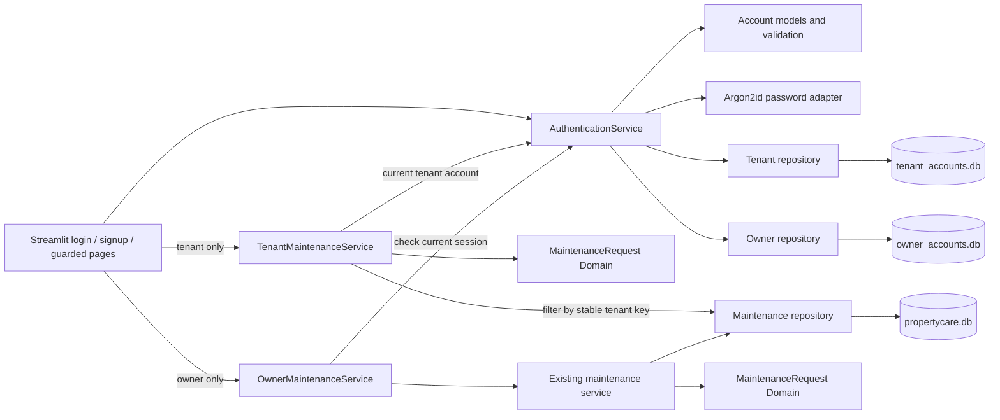

# PropertyCare

[](https://github.com/JaiKaushik03/cen5064-project-Jai/actions/workflows/ci.yml)

**Student:** Jai LNU · **Course:** CEN 5064 Software Design, Fall 2026 · **Partner:** GoldLion72

## Project

PropertyCare is a rental maintenance and work-order project for tenants, property managers, and maintenance contractors. The implemented authentication includes tenant login/signup, a separate owner login, persistent accounts and protected dashboards. This Part 1 review branch connects tenants to private request submission and history.

Tenants use **My maintenance requests** to submit and view only their own requests. Ownership comes from the signed-in account. The existing owner workspace can still view all requests and change allowed priorities. Older unassigned requests remain owner-only; the app never guesses a tenant from an old unit label. Domain still rejects priority changes to Completed requests.

**Authentication review:** [PR #13](https://github.com/JaiKaushik03/cen5064-project-Jai/pull/13) tracks the implementation and merge history for [Issue #12](https://github.com/JaiKaushik03/cen5064-project-Jai/issues/12). GoldLion72 reviewed it on October 25 and suggested two signup improvements; both are implemented. Their review is COMMENTED, not a formal approval. Jai authorized merging after the corrections and verification. The badge above tracks main.

## How to run

Requirements: Git and Python **3.13**. These Windows Command Prompt commands clone the Part 1 review branch. It builds on the unmerged SOLID PR #15; review/merge that PR first, then retarget the Part 1 PR to main. Main currently contains the earlier authentication release:

```bat
git clone --branch codex/tenant-owned-requests https://github.com/JaiKaushik03/cen5064-project-Jai.git
cd cen5064-project-Jai
py -3.13 -m venv .venv
.venv\Scripts\activate
python -m pip install -r requirements.txt
python -m scripts.seed_demo_accounts --local-demo
python -m streamlit run app.py --server.address 127.0.0.1
```

Open **http://localhost:8501** while the server is running. If Streamlit asks for an onboarding email, press Enter to skip it. Stop with **Ctrl+C** and restart with the same Streamlit command.

For PowerShell, activate with `.\.venv\Scripts\Activate.ps1`; use Command Prompt if execution policy blocks activation.

On Linux/macOS with Python 3.13 installed, use `python3.13 -m venv .venv` and `source .venv/bin/activate` in place of the Windows environment commands; the pip, Streamlit, and test commands are the same.

### Local accounts and explicit demo setup

The single demo setup command is:

```bash
python -m scripts.seed_demo_accounts --local-demo
```

The `--local-demo` flag is required. The application does **not** silently seed accounts on startup. The command also refuses a non-local `PROPERTYCARE_ENV` value (such as `production`). These weak, publicly specified credentials are only for this local academic demonstration; do not seed or expose them on a public deployment.

| Login page | Demonstration email | Demonstration password |
|---|---|---|
| Tenant/User | user1@login.com | user1 |
| Tenant/User | user2@login.com | user2 |
| Tenant/User | user3@login.com | user3 |
| Owner | admin@admin.com | admin |

The three tenant profiles use fictional names, reserved example phone numbers, a fictional address, and demo units. Seeding twice does not duplicate accounts, replace hashes/profile details, reset credentials, or consume new IDs. If an account already uses a demo email, its existing credentials remain unchanged. Seeded fictional profiles use a `demo-seed` terms version; this does not claim that a real person accepted terms. Passwords are never prefilled on the login pages.

### Login, signup, and logout

The first screen is **PropertyCare — Rental Maintenance Management System**, with Email address, Password, **Log In**, **Sign Up**, and **Login as Owner**. Main Log In checks the tenant store only. Login as Owner opens a separate owner screen, which checks the owner store only and has no public owner signup.

Tenant signup requires Full Name, Email Address, Phone Number, Address, Unit Number, Password, Confirm Password, and terms acceptance. Email is normalized and unique ignoring case. Phone input accepts common punctuation and 10–15 digits. New passwords require 12–128 characters including a letter and a number; the weak demo passwords bypass that policy only in the explicit local seeder.

The optional updates checkbox starts unchecked and stores a preference only; no notifications are sent. The required terms checkbox starts unchecked. Read the versioned, nonbinding academic terms in the signup expander. The service records the acceptance time and current terms version. Signup validation errors preserve all entered fields, including both masked password inputs, so missing details can be corrected without retyping them. Successful signup confirms account creation, clears the signup form, and returns to tenant login with the saved, normalized email prefilled and an empty password. It never grants owner access.

Tenant login opens a **Tenant Dashboard** showing the registered name, **My maintenance requests**, and Logout. The request screen shares the required Property / Unit and Issue title fields, optional Description, and required Priority dropdown. A successful save resets the form to blank text and Medium priority, keeps the confirmation, and shows the saved owned row. Validation errors retain the entered data. Tenants cannot see or change another tenant's requests or use manager priority controls. Owner login opens a separate **Owner Dashboard** with Logout and an **Open maintenance requests** action for the preserved workflow. Logout revokes the session token and clears application session state. Expired protected sessions and successful new logins also clear old private drafts and feedback. URL parameters cannot select a role or grant protected-page access.

### Database setup and password protection

Authentication databases are created automatically and repeatably on first login-page startup or by the setup command; no database server or manual SQL is needed:

| SQLite file | Stored information |
|---|---|
| `data/tenant_accounts.db` | Tenant ID, stable account key, full name, normalized email, phone, address, unit, password hash, updates preference, terms timestamp/version, and creation timestamp. |
| `data/owner_accounts.db` | Owner ID, normalized email, password hash, and creation timestamp. |
| `data/propertycare.db` | Maintenance requests, optional tenant ownership key, priority and status; initialized when an authorized tenant or owner opens their request screen. |

`PROPERTYCARE_AUTH_DATA_DIR` optionally selects another directory for the two fixed authentication filenames. `PROPERTYCARE_DB_PATH` still overrides only the maintenance database. Tests and browser checks use isolated directories/files. Credential stores reject a file that already contains the opposite account table or a maintenance table; the app rejects a maintenance path pointing at an authentication file. No existing database is overwritten. Database files are ignored by Git.

Passwords use salted **Argon2id** through pinned [argon2-cffi](https://pypi.org/project/argon2-cffi/) 25.1.0, with 64 MiB memory, three iterations, and parallelism four. SQLite stores hashes, not plaintext or reversible credentials. Different hashes have fresh library-generated salts.

Authentication session state contains an opaque random token, not a password or a browser-supplied role. The server resolves its role/account/store identity and rechecks the database account. Password inputs necessarily exist transiently in Streamlit's widget memory while being entered; callbacks clear them after every login attempt, successful signup, navigation, and logout. After a failed signup, both masked password inputs remain only in the active form for correction; they are cleared when the user leaves signup. No plaintext password is retained in the authenticated session, stored in account rows, or logged. This is a local course application; public deployment, rate limiting, email verification, password recovery, and a production identity provider are separate work.

The existing status migration is retained. If `status` is missing, the repository adds `status TEXT NOT NULL DEFAULT 'Open'` in a transaction. Old rows become Open, and IDs, fields, priorities, timestamps, and the ID sequence are preserved. Repeated initialization does not recreate the table or add duplicate columns. Part 1 also adds a nullable `tenant_key` column and index without assigning old rows. Open/Completed remains the current minimal state model; no completion UI is added here.

## How to test

From the repository root, with the virtual environment activated:

```bash
python -m pip install -r requirements-dev.txt
python -m pytest -q
```

Tests cover separate-store login, cross-role rejection, signup/profile/password/consent rules, secure hashes, opt-in/idempotent seeding, store identity, persistence, protected routes, logout, and the preserved maintenance rules/SQLite/screen flows. The Part 1 branch contains **225 tests**: all 184 SOLID-branch cases plus 41 ownership/migration/tenant-screen cases. Merged main has the earlier 173-case authentication baseline. The previous 75 cases remain, with maintenance screen tests now performing real owner login before their original assertions.

Run the professor's two required service/SQLite cases separately with:

```bash
python -m pytest -q tests/test_priority_updates.py -k "allowed_change or completed_change"
```

The allowed case saves an Open request, changes Medium to High, checks every stored field, and reloads through a fresh repository/service. The rejected case uses a Completed request, checks the meaningful Domain error, proves the repository update method was never called, and reloads the unchanged stored record. Additional tests cover all four priorities, invalid values, missing IDs, immutable replacements, repeated old-schema migration, ID sequence preservation, stale status, connection cleanup, UI success/error, and restart persistence.

## Architecture

| Layer | Implementing files | Responsibility |
|---|---|---|
| Presentation | `app.py`, `src/presentation/auth_views.py`, `src/presentation/maintenance_view.py` | Composition and guarded routing, login/signup/landing screens, session/widget callbacks, and the preserved owner maintenance UI. No SQL. |
| Service | `src/services/authentication_service.py`, `authentication_ports.py`, `passwords.py`, `demo_accounts.py`, `owner_maintenance_service.py`, `tenant_maintenance_service.py`, and the existing maintenance service | Signup/login through service-owned interfaces, injected Argon2id/SQLite adapters, opaque server sessions and role/store checks, explicit demo setup, owner-authorized maintenance delegation and tenant-scoped request use cases. |
| Domain | `src/domain/accounts.py` and existing maintenance/priority/status modules | Immutable account/profile data, email/phone/password/consent rules, roles, stable tenant/request identity, and existing maintenance validation. No UI, hashing-library, or database dependency. |
| Data | `src/data/account_repositories.py`, `src/data/maintenance_request_repository.py` | Separate tenant/owner SQLite stores, bound reads/inserts, uniqueness and store separation, transaction/connection cleanup, repeatable ownership migrations and tenant-filtered request queries. |



### SOLID refactor: Dependency Inversion

The Lecture 5 refactor is tracked by [Issue #14](https://github.com/JaiKaushik03/cen5064-project-Jai/issues/14)
on `codex/solid-authentication-dip`, awaiting partner review. Main's badge above
continues to describe merged main; the refactor PR checks describe this branch.

`AuthenticationService` already accepted repository arguments, but it imported
the concrete SQLite classes, rejected other implementations, compared database
paths directly, and constructed `Passwords()` when no adapter was supplied.
That tied authentication policy to its storage and hashing implementations.

The service now depends on `TenantAccountStore`, `OwnerAccountStore`, and
`PasswordCodec` protocols in `src/services/authentication_ports.py`. The cached
startup factory in `src/presentation/auth_views.py` supplies the existing SQLite
repositories and Argon2id adapter. Protocols use structural typing: an adapter
provides the required operations without inheriting from the SQLite classes.
Store roles and distinct identities are still validated; these interfaces are
internal startup dependencies, not a way for browser users to choose roles.

The visible workflows, password settings, account files, schema, session checks,
and earlier signup corrections remain the same. In-memory service tests prove
that another adapter works without changing authentication policy. A fresh-process
test also blocks SQLite/Argon2 adapter imports when importing that policy.

For a separate review clone:

```bash
git clone --branch codex/solid-authentication-dip https://github.com/JaiKaushik03/cen5064-project-Jai.git propertycare-solid-review
```

Use the normal environment, installation and demo setup commands inside that
clone. Run the focused tests with `python -m pytest -q tests/test_authentication_ports.py`
and the full suite with `python -m pytest -q`. See [the refactor explanation and
verification](docs/solid-refactor.md). Tenant-owned requests and the remaining
owner features are separate work.

## Part 1: tenant-owned requests and history

[Issue #16](https://github.com/JaiKaushik03/cen5064-project-Jai/issues/16) tracks
`codex/tenant-owned-requests`. Its PR targets `codex/solid-authentication-dip`
while [PR #15](https://github.com/JaiKaushik03/cen5064-project-Jai/pull/15) awaits
review. This keeps the new diff focused. After #15 merges, retarget the Part 1
PR to main and recheck CI before considering its merge.

Tenant request ownership uses a persistent UUID account key. It is independent
of the account's numeric ID, email spelling and database path. Service obtains
the current account from the server-issued session for every submit/list/lookup;
forms and URLs cannot choose the owner. Repository queries bind the key in SQL.
Another tenant's request ID and a missing ID produce the same not-found result.

On an existing tenant database, initialization adds `account_key`, backfills one
UUID per account, and creates a unique index in one transaction. The keys survive
restarts and relocation. The request migration adds nullable `tenant_key` and an
index in its own transaction; all existing rows stay NULL and owner-only. No IDs,
hashes, original fields or sequences are rebuilt. Repeated setup does not change
assigned keys. Sessions also bind the tenant key so a replacement account cannot
reuse an earlier tenant's session or inherit history through a reused numeric ID.

The two files remain separate SQLite stores; Service enforces their relationship.
Keep account and request database backups together to preserve ownership links.
The current property/unit label is required free-form text, not a registered-unit
authorization system. Tenant contact snapshots, the new owner Active Issues view,
and completion UI remain Parts 2 and 3. See [migration and verification details](docs/tenant-request-verification.md).

## Maintenance request workflow

**Preserved owner workspace:** In Owner Dashboard, open maintenance requests. The owner submits a legacy request -> service validates by creating the
domain model -> SQLite repository saves -> service loads saved requests ->
Streamlit displays confirmation and the stored record.

Priority must be exactly **Low, Medium, High, or Critical**,
using the existing `Priority` enum. Property / Unit and Issue title must contain
non-whitespace text. Description is optional free-form text: digits such as `"123"` are valid text, while non-string values are rejected. There is no alphabetic-only description rule. Invalid data raises a domain
validation error before the service calls storage; the UI displays that error.

Fields marked * are required. After a successful save, the text fields clear and priority resets to Medium; the confirmation and saved request remain visible. Validation errors preserve entered values.

### Manager priority-change workflow

**Domain owns the business rule that completed maintenance requests cannot have their priorities changed.** `MaintenanceRequest.change_priority()` rejects Completed requests and returns a validated replacement for an Open request. The original dataclass stays frozen. Low, Medium, High, and Critical remain the only valid priorities.

**Service coordinates retrieval, validation, and persistence.** `change_priority(request_id, priority)` retrieves the request, reports a missing ID, calls the Domain method, and persists the returned object only if validation succeeds. It does not repeat the Completed decision.

**Data layer performs SQLite reads and writes.** `get_by_id()` uses a bound ID; `update_priority()` updates only the priority with bound parameters and commits the transaction. A status-match condition rejects a stale record if its status changed between lookup and update. That generic consistency check does not decide which status permits an edit; Domain owns that decision.

To use the interface:

1. Log in as owner and open maintenance requests. Submit a legacy request or use an existing saved request. The table shows its ID, priority, and status.
2. In **Manager - Change Request Priority**, select the request by ID/title/property.
3. **New priority** starts at the selected request's saved priority. Selecting another request immediately loads its current priority without saving a change. Choose the desired priority and click **Update Priority**.
4. For an Open request, the app displays success and reloads the saved table with the new priority. The same ID, details, timestamp, and status remain.
5. For a Completed request, the app displays the Domain validation error. Its priority stays unchanged and the manager's selection is preserved. A missing/deleted request produces a clear error.

The submission Priority starts at Medium and resets to Medium after a successful save. The manager's New priority starts at the selected request's current value. Session state supplies these values; an unrelated rerun or failed update keeps the proposed manager value for the same request. Update callbacks run before the next screen render. Dependent widget state is assigned before that widget is rendered. Completed fixtures are exercised in automated tests; this demo does not provide a completion button.

## ADRs

| Decision | Status |
|---|---|
| [ADR 001: Layered Architecture](docs/adr/adr-001-layered-architecture.md) | accepted |
| [ADR 002: SQLite Persistence](docs/adr/adr-002-sqlite-persistence.md) | accepted |
| [ADR 003: Separate authentication stores and protected legacy workspace](docs/adr/adr-003-separate-authentication.md) | accepted; October 25 follow-up recorded |
| [ADR 004: Stable tenant/request ownership](docs/adr/adr-004-tenant-request-ownership.md) | proposed in Part 1 PR |

The original ADR template and worked example remain as course references.
They are not counted as PropertyCare decisions.

## CI

GitHub Actions uses Python 3.13 and runs `python -m pytest -q` for pushes to `main` and pull requests targeting `main` or `codex/**` branches. The feature-branch filter supports the separate stacked review PRs. The badge at the top shows CI for pushes to `main`.

## Demo

1. Run demo setup, start Streamlit, and open http://localhost:8501.
2. Log in as `user1@login.com` / `user1`, then open **My maintenance requests**.
3. Submit a fictional request. Show its confirmation, form reset and saved row.
4. Log out and log in as `user2@login.com` / `user2`. User 1's request is absent;
   user 2 can submit a separate request and see only their own history.
5. Log out and use **Login as Owner** with `admin@admin.com` / `admin`.
   Open the existing workspace to see all requests, including unassigned legacy rows.
6. Change an Open request's priority. Completed fixtures still reject changes;
   no completion button is implemented yet.
7. Stop/restart the app, log in as each tenant again, and show private persisted
   history. Signup and the earlier validation/password-retention/email-prefill flow remain available.

## Semester scope and future work

The broader design still includes registered properties/units, owner Active Issues and Fixed Issues tables, confirmed Mark Fixed actions, assignment, optional images, maintenance history, and repair costs. These are **planned**, not implemented by this authentication PR. The full owner portal in Issue #1 remains unfinished.

The exact future fields, required dialog/checkbox/Submit sequence, data retention, timestamps, owner-only access, and Domain transition responsibilities are recorded in [the future owner workflow](docs/future-owner-workflow.md). Part 1 implements the ownership migration and private tenant history; the current Completed state is not renamed to Fixed.

The original C4/UML diagrams and priority/image design remain in [the planned full-semester design](docs/planned-design.md).
[Issue #5](https://github.com/JaiKaushik03/cen5064-project-Jai/issues/5) tracks the maintenance request workflow.
[PR #4](https://github.com/JaiKaushik03/cen5064-project-Jai/pull/4) documents the original priority rule and AI critique.

## Project tracking

[PropertyCare Midterm Board](https://github.com/users/JaiKaushik03/projects/1) tracks completed maintenance features and planned semester work.

| Work | Implementation status | Tracking |
|---|---|---|
| Four supported priorities and Domain validation | Implemented | [Issue #3](https://github.com/JaiKaushik03/cen5064-project-Jai/issues/3) |
| Submit, validate, save, and display maintenance requests | Implemented | [Issue #5](https://github.com/JaiKaushik03/cen5064-project-Jai/issues/5), [PR #7](https://github.com/JaiKaushik03/cen5064-project-Jai/pull/7) |
| Change priority for Open requests; reject Completed requests | Implemented, with partner feedback addressed | [PR #9](https://github.com/JaiKaushik03/cen5064-project-Jai/pull/9) |
| Tenant/owner login, tenant signup, protected landing pages | Implemented; partner signup feedback addressed | [Issue #12](https://github.com/JaiKaushik03/cen5064-project-Jai/issues/12) |
| Full owner portal with tenant contact details and assigned work | Planned; not implemented | [Issue #1](https://github.com/JaiKaushik03/cen5064-project-Jai/issues/1) |
| Tenant-owned request submission and personal history | Implemented on Part 1 review branch; unmerged | [Issue #16](https://github.com/JaiKaushik03/cen5064-project-Jai/issues/16) |
| Completion action and manual lifecycle demonstration | Planned; not implemented | [Issue #10](https://github.com/JaiKaushik03/cen5064-project-Jai/issues/10) |

## Development and verification

Jai LNU set the project direction, provided the requirements and professor feedback, and defined the acceptance criteria. Codex performed most of the coding, including the Domain changes, service coordination, SQLite migration, Streamlit interface, automated tests, and implementation documentation. Codex also ran the technical checks recorded in [the verification history](docs/verification.md) and [October 24 authentication evidence](docs/authentication-verification.md); these results do not claim that Jai personally ran those checks or wrote every line.

GoldLion72 reviewed the priority-change implementation in [PR #9](https://github.com/JaiKaushik03/cen5064-project-Jai/pull/9#pullrequestreview-5564434492). Their feedback led to matching New priority to the selected request's current value. Their suggestion for a completion UI is recorded in [Issue #10](https://github.com/JaiKaushik03/cen5064-project-Jai/issues/10), since that workflow is outside this priority-change assignment. The review was submitted as comments; the PR records its review and approval status.

## Weekly log

- Week 1 (Aug 24): Repository created, three project ideas drafted, PropertyCare selected, and the approval paragraph added.
- Week 2 (Aug 31): Defined the four-tier architecture and its responsibilities.
- Week 3 (Sep 7): Created C4 diagrams, the initial UML class diagram, and the maintenance-request sequence.
- Week 4 (Sep 14): Expanded the planned design with optional images and four priority levels.
- Week 5 (Sep 21): Started Issue #1's planned login and owner portal workflow documentation.
- Week 6 (Sep 28): Implemented Domain priority validation, unit tests, AI critique, and peer-review README feedback.
- Week of Oct 5 (Oct 10): Implemented the submit-and-view workflow, SQLite persistence, interface/integration tests, two real ADRs, CI, and reproducible run instructions.

- Oct 10 follow-up: Re-audited existing work, corrected issue/PR descriptions and attribution, verified feature-branch setup, and added service/storage-boundary checks for partner review.

- Oct 18: Added manager priority updates, Domain-owned Completed restriction, minimal request status, safe SQLite migration, and regression coverage. Local suite: 69 passed, 0 failed. Verified both real browser workflows and restart persistence against an isolated legacy database; the initial implementation was handed off as a Draft PR before peer review.

- Oct 18 partner-review follow-up: Matched the manager priority default to the selected request, added selection/rerun regression tests, clarified contribution credit, and recorded the completion UI as future Issue #10. Jai subsequently authorized merging the corrected implementation without a second review; the recorded partner review remains COMMENTED, not a formal approval.

- Oct 24: Jai supplied the authentication/signup flow, fields, account separation, demo credentials, interface decisions, and future owner workflow requirements. Codex implemented the authentication slice, preserved maintenance behavior behind owner access, and performed the automated/database/browser verification. The initial handoff was an open PR for peer review; see the October 25 follow-up below.


- Oct 25 partner-review follow-up: GoldLion72 suggested preserving signup passwords after validation errors and prefilling the login email after account creation. Codex implemented both using form callbacks, added retry/navigation/prefill regression checks, and ran all 173 tests successfully. Jai authorized merging the corrected PR after verification; the partner review remains COMMENTED, with no formal approval claimed.

- Oct 30–31: Refactored authentication around service-owned account/password interfaces for Lecture 5 Dependency Inversion. Added independent in-memory tests, retained the 173-case baseline, and verified 184 passing tests plus the unchanged browser workflows. The SOLID PR is awaiting partner review.

- Oct 31: Added Part 1 tenant-owned requests and private history, stable account keys, repeatable legacy migrations, session/draft isolation and 41 new cases. Full branch suite: 225 passed. Verified two-tenant privacy and restart behavior in Chrome against isolated data; verified migration copies preserve existing records. The Part 1 PR remains separate and unmerged for review.
