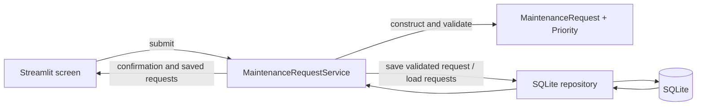

# PropertyCare

[](https://github.com/JaiKaushik03/cen5064-project-Jai/actions/workflows/ci.yml)

**Student:** Jai LNU · **Course:** CEN 5064 Software Design, Fall 2026 · **Partner:** GoldLion72

## Project

PropertyCare is a rental maintenance and work-order project for tenants, property managers, and maintenance contractors. The current working feature lets a tenant submit and view a maintenance request. Requests are validated, stored in SQLite, and displayed again after restarting the application.

## How to run

Requirements: Git and Python **3.13**. Run these commands in Windows Command Prompt to clone and start the current feature branch:

```bat
git clone --branch maintenance-request-working-slice https://github.com/JaiKaushik03/cen5064-project-Jai.git
cd cen5064-project-Jai
py -3.13 -m venv .venv
.venv\Scripts\activate
python -m pip install -r requirements.txt
python -m streamlit run app.py
```

Open **http://localhost:8501** while the server is running. If Streamlit asks for an onboarding email, press Enter to skip it. Stop with **Ctrl+C** and restart with the same Streamlit command.

For PowerShell, activate with `.\.venv\Scripts\Activate.ps1`; use Command Prompt if execution policy blocks activation.

### Database setup

The first run creates `data/propertycare.db` and its table automatically; no database server, credentials, or schema commands are needed. Requests remain after restarting. The default database path is relative to `app.py`.

Database files are ignored by Git. Optional `PROPERTYCARE_DB_PATH` selects another file; tests use isolated databases.

## How to test

From the repository root, with the virtual environment activated:

```bash
python -m pip install -r requirements-dev.txt
python -m pytest -q
```

Tests cover priority rules, required fields, validation before saving, SQLite save/load and persistence, and the Streamlit screen flow.

## Architecture

| Layer | Implementing files | Responsibility |
|---|---|---|
| Presentation | `app.py` | Streamlit form, validation messages, and saved-request table; wires the repository and service together. |
| Service | `src/services/maintenance_request_service.py` | Coordinates submission: constructs the domain object before saving, and loads requests for display. |
| Domain | `src/domain/maintenance_request.py`, `src/domain/priority.py` | Maintenance request data and validation; no UI or database dependency. |
| Data | `src/data/maintenance_request_repository.py` | Automatic SQLite setup, parameterized inserts, committed storage, and loading domain objects. |



## Maintenance request workflow

**Flow:** Tenant submits request -> service validates by creating the
domain model -> SQLite repository saves -> service loads saved requests ->
Streamlit displays confirmation and the stored record.

The main rule is that priority must be exactly **Low, Medium, High, or Critical**,
using the existing `Priority` enum. Property / Unit and Issue title must contain
non-whitespace text. Description is optional. Invalid data raises a domain
validation error before the service calls storage; the UI displays that error.

Fields marked * are required. After a successful save, the text fields clear and priority resets to Medium; the confirmation and saved request remain visible. Validation errors preserve entered values.

## ADRs

| Decision | Status |
|---|---|
| [ADR 001: Layered Architecture](docs/adr/adr-001-layered-architecture.md) | accepted |
| [ADR 002: SQLite Persistence](docs/adr/adr-002-sqlite-persistence.md) | accepted |

The original ADR template and worked example remain as course references.
They are not counted as PropertyCare decisions.

## CI

GitHub Actions uses Python 3.13 and runs `python -m pytest -q` for pushes to `main` and pull requests targeting `main`. The badge at the top shows checks for `maintenance-request-working-slice`.

## Demo

1. Open http://localhost:8501.
2. Enter **Oak Court / Unit 2B**, **Leaking kitchen sink**, and **Water pools below the cabinet.** Select **Critical**.
3. Click **Submit request**. Show the success message and matching row in **Saved maintenance requests**.
4. Stop the server with Ctrl+C, restart with `python -m streamlit run app.py`, and refresh the browser. Show that the row remains.
5. Leave Issue title blank and click **Submit request**. Show the validation message and that the saved-request count does not increase.
6. Show the README layer table and green CI badge; briefly show the passing test result.

## Semester scope and future work

The broader design includes registered properties and units, login and role-based
owner access, optional request images, work orders, assignment, status updates,
maintenance history, and repair costs. These features are planned and are **not**
implemented in the current application. The original C4/UML diagrams and priority/image
design are preserved in [the planned full-semester design](docs/planned-design.md).

[Issue #5](https://github.com/JaiKaushik03/cen5064-project-Jai/issues/5) tracks the maintenance request workflow.
[PR #4](https://github.com/JaiKaushik03/cen5064-project-Jai/pull/4) documents the original priority rule and AI critique.

## Development and verification

Jai LNU owns and directs PropertyCare's scope, requirements, architecture, and acceptance criteria. AI-assisted tools contributed portions of the code, tests, CI, and technical documentation. [Verification evidence](docs/verification.md) records checks and observed results.

## Weekly log

- Week 1 (Aug 24): Repository created, three project ideas drafted, PropertyCare selected, and the approval paragraph added.
- Week 2 (Aug 31): Defined the four-tier architecture and its responsibilities.
- Week 3 (Sep 7): Created C4 diagrams, the initial UML class diagram, and the maintenance-request sequence.
- Week 4 (Sep 14): Expanded the planned design with optional images and four priority levels.
- Week 5 (Sep 21): Started Issue #1's planned login and owner portal workflow documentation.
- Week 6 (Sep 28): Implemented Domain priority validation, unit tests, AI critique, and peer-review README feedback.
- Week of Oct 5 (Oct 10): Implemented the submit-and-view workflow, SQLite persistence, interface/integration tests, two real ADRs, CI, and reproducible run instructions.

- Oct 10 follow-up: Re-audited existing work, corrected issue/PR descriptions and attribution, verified feature-branch setup, and added service/storage-boundary checks for partner review.
