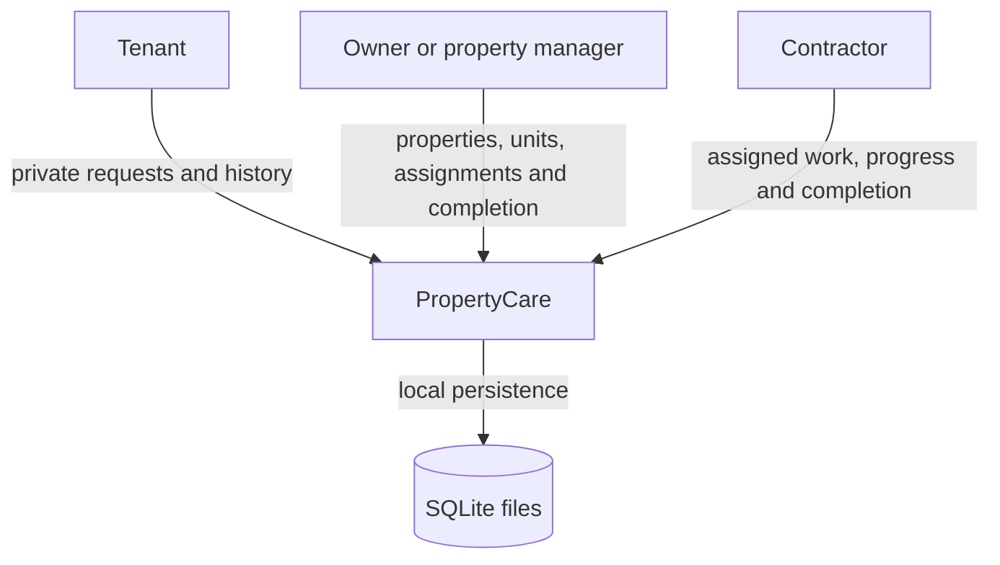
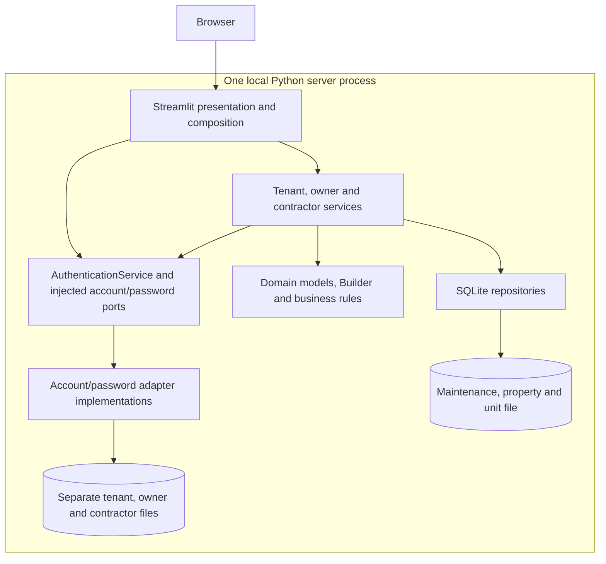
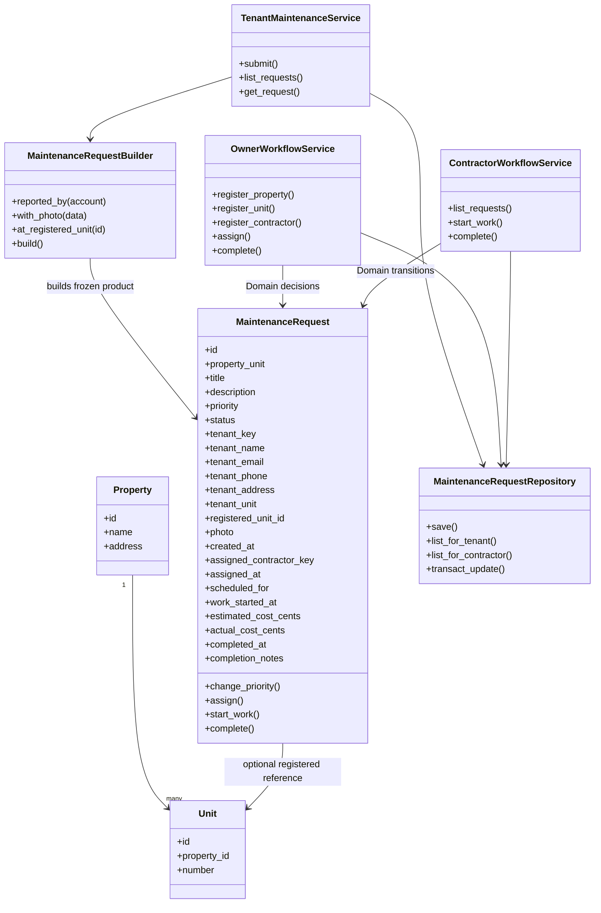
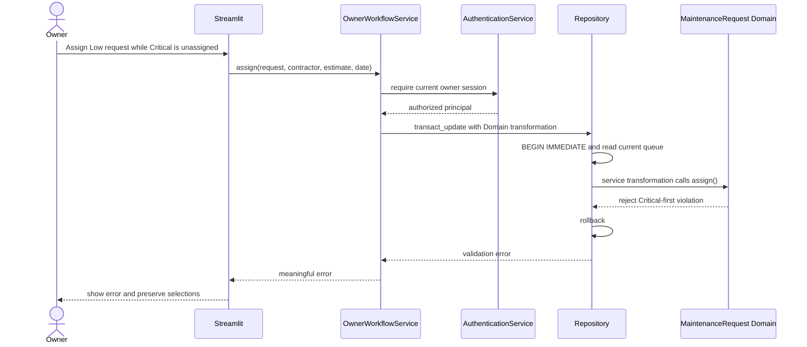

# PropertyCare final design

## Scope and actors

The final course application supports tenant signup/login and private maintenance submission, owner property/unit registration and contractor provisioning, owner assignment oversight, contractor progress/completion, and retained maintenance history with photos and repair costs. Owners share one local management portfolio. Tenant identities and contractor assignments use stable keys. The application does not claim lease verification, payment processing or public production hosting.

## Context and containers

Presentation handles widget state, form callbacks and rendering; it contains no SQL. Service obtains the current principal on every operation and coordinates Domain/Data. Domain owns required-field/priority constraints, contact completeness, costs/photos, Critical-first assignment and immutable completion. Data uses bound parameters and manages transactions/connections. The new workflow update transaction takes a service-supplied transformation; the repository itself does not decide whether Critical assignment or completion is permitted.

## Current class relationships

Work-order assignment/progress/cost values live in the MaintenanceRequest aggregate. There is no separate WorkOrder class or table; the original proposal's WorkOrder diagram is historical. Account models and service-owned ports remain as documented in ADRs 003/004 and the SOLID refactor.

## Assignment sequence and rejection

Completion follows the same authorization/transaction path and calls Domain complete(confirmed=True). UI requires both the checkbox and Submit. Contractor transformations additionally compare the assigned stable key inside the transaction. A rejected transition writes nothing. Successful completion retains all original fields, changes stored status to Completed and records exact actual cost, completion notes and UTC time. Subsequent priority changes fail in Domain.

## Persistence and migration

Tenant, owner and contractor credentials remain in separate files with Argon2id hashes. The maintenance file has properties, units and extended maintenance_requests. The registered unit reference is optional for legacy/free-form requests; duplicate units are rejected per property and unit registration requires an existing property. Images are bounded PNG/JPEG bytes in SQLite. All SQL inputs are bound; internal schema identifiers come from fixed code.

Additive migration runs within one transaction and preserves existing values, IDs, account keys, hashes and ID sequences. Legacy unknown contacts are never joined to a possibly changed profile as if historical. Old Completed timestamps remain unknown. Backups cover all four files together.

## Final plan and risks

| Risk | Mitigation and evidence |
|---|---|
| Cross-account disclosure | Current-role/account rechecks, stable keys and filtered repository reads; tenant/contractor isolation and replacement-account tests |
| Losing old data during migration | Additive transactions, repeated migration/rollback tests, copied legacy stores and original file checksums |
| Assignment race | Serialized current-queue read and Domain decision in BEGIN IMMEDIATE |
| Completion changes original history | Frozen replacements, updates limited to workflow fields, preservation/reload tests |
| Malformed images or costs | Decode actual PNG/JPEG content with size/pixel limits; exact Decimal-to-cent validation |
| Streamlit widget errors | Callback resets before rendering; dynamic upload key after success; real screen tests and browser checks |
| Unsupported production assumptions | Document local-process sessions, shared owner portfolio, backup scope and no lease/payment claims |

Implementation is handed off in a single open feature PR with logical commits. Partner review and explicit final merge approval remain the stopping point; no review or approval is invented. Weekly reviews/commits are a continuing course process and cannot be reconstructed after the fact. See final-verification.md for actual receipts and the pattern map for the creational assessment.
